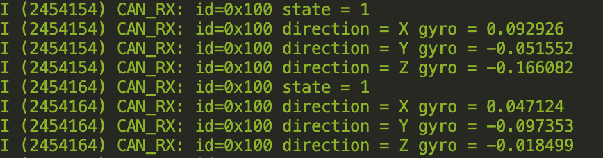
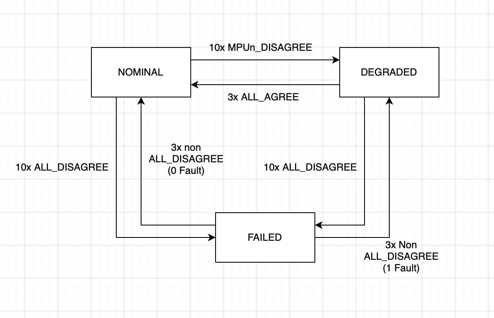
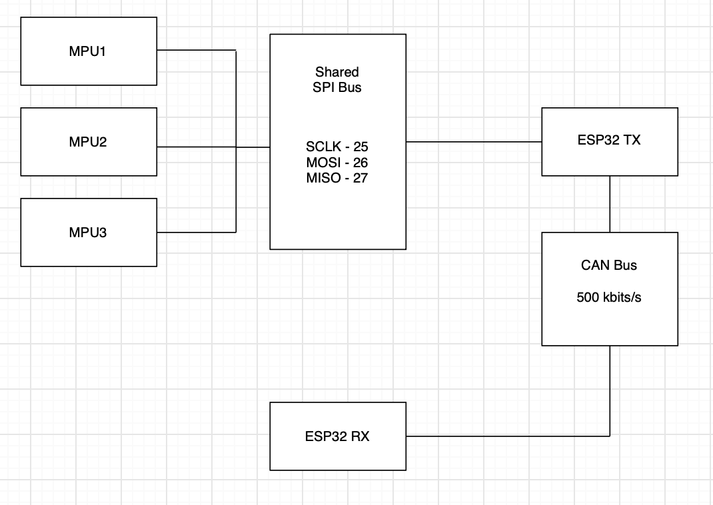
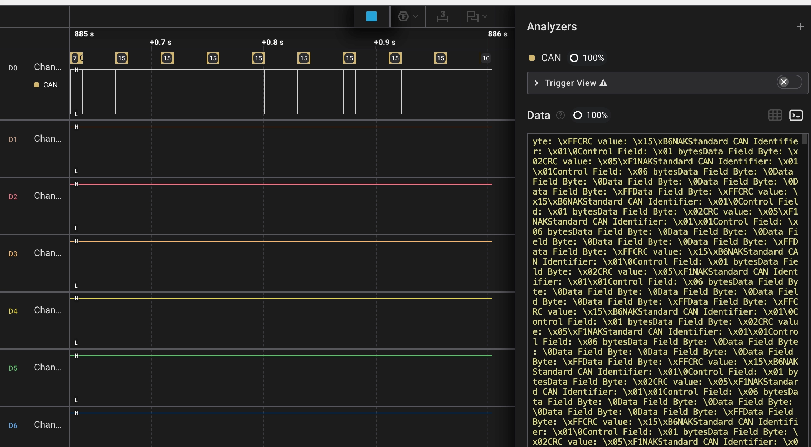

# Triple Redundant IMU with Fault Detection, Isolation, and Recovery on ESP32

## Description

Three MPU9250 IMUs on a shared SPI bus, sampled and voted against each other at 100Hz. Fused results and a system health state are broadcast over CAN to a second ESP32.

A single sensor gives you no way to know when it is lying. This system compares three independent outputs every cycle, identifies which one of them disagrees, excludes it from the output and sends out a confidence level (the system state) alongside the data.

Triple modular redundancy with a fault detection, isolation and recovery layer is a standard pattern for safety-critical systems in automotive and aerospace industries. This is a prototype implementation of that pattern on ESP32 hardware. A qualified system would need considerably more than this. Known Limitations covers the gaps I consider most important. Although, it is not exhaustive.


<p align="center">
  
  <br>
  <em>Output on the receiving node. Each cycle arrives as four CAN frames: the system state, X, Y and Z gyro axes at 100 Hz.</em>
</p>


## At a glance

- Sample Rate - 100Hz 
- End to end chain time - 126µs (Down from 679µs)
- SPI collect time - 12µs (down from 449µs)
- Fault detection latency - 100ms (10 consecutive samples)
- Recovery latency - 30ms (3 consecutive samples)
- CAN - 500 kbits/s

<!-- -->

<p align="center">


</p>


- SPI SCLK/MOSI/MISO 25/26/27
- CS Pins 5,4,15
- CAN TX/RX 21/23 | 21/22

## How it Works

Reader_task (priority 5) wakes up every 10ms via vTaskDelayUntil, so the period does not drift with however long the work took. It collects readings from each of the three sensors, converts raw registers to floats and subtracts calibration offsets derived during the initial setup of the system. All three readings are pushed to the queue as a single item and then handed to a "voter_task" (priority 4). "voter()" compares the three readings and returns: ALL_AGREE, MPU<N>_DISAGREE, or ALL_DISAGREE. "update_state()" turns the voting result into a system condition - NOMINAL, DEGRADED, or FAILED. average_good() averages the sensors that are still trusted, and excludes any identified outlier. At the end, the state and the three fused gyro axes go out as four CAN frames.

## Design

The goal was to minimize the time it takes between issuing a read request and having an updated system state, in a way that the loop rate can be increased in the future without redesigns. This has been achieved by 2 core design decisions:

DMA - The bus is opened with "SPI_DMA_CH_AUTO". As a result, moving bytes from the SPI bus into RAM does not consume CPU cycles, and while this is occurring the CPU is able to run the voting algorithm and update the state.

Requesting the read cycle in advance - This made the largest difference. Instead of requesting a read and waiting for it, the code collects transfers queued during the previous cycle and immediately queues the next set into the other half of the double buffer. By the time data is needed, it has already arrived, so the collect step is just extracting completed results instead of waiting on the wire. However, the cost of this is that the data read is one cycle old, which can be problematic in a real-world system.

Other key design considerations include:

SPI over I2C - for developing a driver for MPU9250, I decided to use SPI over I2C. MPU9250 has only two I2C addresses. Therefore, for the third sensor, I would need either an I2C multiplexer or a second bus. 

Electrical noise - was pushing the system into DEGRADED and FAILED and then straight back out again. To stop this, a state change now requires 10 consecutive disagreements rather than a single one. Noise almost never survives ten times in a row, but a faulty sensor does. This made the system more robust. However, the cost is that no fault can be detected faster than 100 ms.

## Testing

The voting and FDIR logic are not dependent on hardware, so they can compile and run on a development machine:

```sh
./test/test.sh
```

The script builds voting.c and fdir.c against a fault-injection program that fakes IMU readings, corrupts selected units, and executes the real voter() and update_state().

```
all healthy -> NOMINAL (voter: ALL AGREE) PASS
MPU1 breaks -> DEGRADED (voter: MPU1 DISAGREE) PASS
MPU1 healed -> NOMINAL (voter: ALL AGREE) PASS
MPU1+MPU2 break -> FAILED (voter: ALL_DISAGREE) PASS
MPU2 healed -> DEGRADED (voter: MPU1 DISAGREE) PASS
MPU1 healed -> NOMINAL (voter: ALL AGREE) PASS
both break again -> FAILED (voter: ALL_DISAGREE) PASS
both healed -> NOMINAL (voter: ALL AGREE) PASS
both break again -> FAILED (voter: ALL_DISAGREE) PASS
not enough readings to heal -> FAILED (voter: ALL AGREE) PASS
both break again -> FAILED (voter: ALL_DISAGREE) PASS
both healed -> NOMINAL (voter: ALL AGREE) PASS
less than 10 broken readings -> NOMINAL (voter: ALL_DISAGREE) PASS

ALL TESTS PASSED
```

## Build and Run

Requires ESP-IDF 6.1. The transmitter and receiver share one project, selected with the ROLE cache variable:

```sh
idf.py -DROLE=tx build flash monitor     # transmitter
idf.py -DROLE=rx build flash monitor     # receiver
```

The console runs at 921600 baud. At the default 115200 the receiver cannot print one line per CAN frame fast enough to keep up with the data, and the TWAI driver silently drops whatever does not fit in its queue.

Host-side logic tests, no hardware required:

```sh
./test/test.sh
```

## Problems Encountered

CAN bus: Debugging my first CAN bus implementation took four days. I started with a simple two-node network and transmit/receive code to understand the protocol in practice. The receiver logged nothing, so I used a logic analyzer, which showed the transmitter was putting frames on the bus but getting no ACK. I swapped transceivers and ESP32 boards and tested different CAN libraries. I also measured CANH–CANL resistance with a multimeter and added termination resistors manually, but that did not solve the issue either. In the end, by flashing identical transmit and receive code onto each ESP32, I isolated the fault to a specific board: one ESP32 (bought locally in Georgia) could receive CAN frames but consistently failed to transmit them. I worked around it by assigning the faulty board the receive-only role in my project.
<p align="center">
  
  <br>
  <em>Saleae capture during CAN bring-up. The TX board is framing valid frames, but every frame is NAKed and no node acknowledges on the bus</em>
</p>

IMU Static Bias: when stationary, one sensor might read -1 g on Z and another -1.5 g. Since my FDIR layer votes on agreement between the three, an uncorrected offset would make healthy sensors disagree and trigger false DEGRADED transitions. So at startup I average a few hundred stationary samples per sensor and store a per-axis offset. Then, before the values reach the voting stage, I subtract the offsets from MPU readings. On the accel Z axis I subtract only the excess beyond 1 g, so I remove bias without removing gravity.

FDIR (lessons learned): I began implementing the FDIR logic before I defined the state set or the transition rules. Without that plan, development became very chaotic. I was fixing one bug after another while the actual state machine design was still forming in my head. The takeaway is that the FDIR logic and its states/transitions should be defined upfront before writing the code.

Electrical Noise: The state machine escalated from NOMINAL to DEGRADED or FAILED. The reason behind this was electrical noise occurring randomly at high reading frequencies. I solved the issue by allowing state change only after 10 consecutive voting disagreements.

MPU9250 latching into a bad state: a few times during testing, a brief SPI glitch (caused by disturbing the wiring to cause a fault on purpose) desynchronized the SPI interface mid-transaction. Because of that, reflashing was not clearing the issue, and the sensors were giving me a wrong static reading. The issue was only solved after a full power cycle.

## Known Limitations

4 CAN Frames: Each sample goes out as four separate CAN frames. Three of them are carrying one float each (one axis of gyro data) plus a state frame carrying an integer. A standard CAN frame has 47 bits of protocol overhead, so a 5-byte payload frame is 87 bits on the wire. Four frames per sample becomes 316 bits, compared to 111 bits for a single 8-byte frame carrying the same data. The biggest problem with this is atomicity. If I lose one frame, I lose a single axis and the receiver can't tell that it's processing a corrupted sample. The fix is to pack all axes plus the state into one 8 byte frame.

The redundancy stops at the sensors: The sensors share a single SPI bus and a single processor. A fault in any of those affects all three sensors at once, and the voter cannot differentiate whether the bus died or all three sensors failed.

Majority Voting: If two sensors fail in the same way (for example both of them lost power and read 0 on each axis), they will agree with each other and the healthy sensor will be isolated. Majority voting cannot distinguish this case.

Calibration assumes a known startup orientation: The calibration function assumes that all of the sensors are stationary with an orientation that results in the Z axis experiencing a -1g gravity force. If, during startup, the system is not in this assumed position, the calibration offsets will be miscalculated.

Nothing is transmitted when the system is in the failed state: can_send_state() is inside the if(average_good()) guard, and average_good() returns false on ALL_DISAGREE. This means that on failure, the receiving node cannot distinguish the FAILED state from a dead transmitter.

## Repository Layout

```
main_tx/main.c        Setup and reader and voter loops
main_tx/mpu9250.c     SPI setup, queued DMA bursts, calibration
main_tx/voting.c      Comparison and majority vote
main_tx/fdir.c        FDIR state machine
main_tx/fusion.c      Averaging while excluding outlier
main_tx/tx.c          TWAI/CAN transmit with bus-off recovery
main_rx/main_rx.c     Receiver
test/fault_inject.c   Host-side fault injection test
test/test.sh          Build and run the test
CMakeLists.txt        Role switch - selects main_tx or main_rx as the component dir
```
